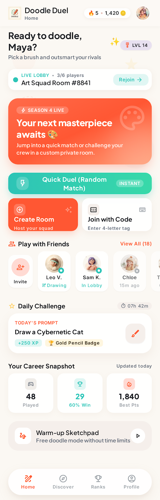
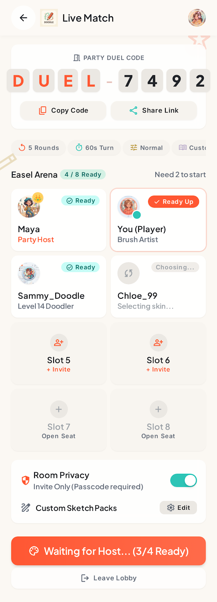
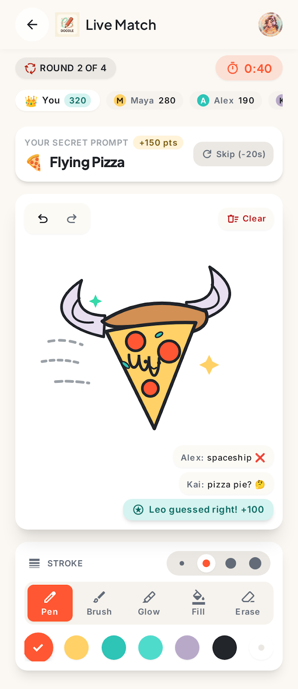
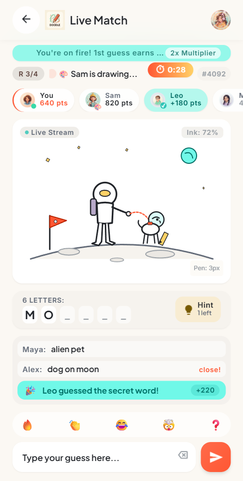
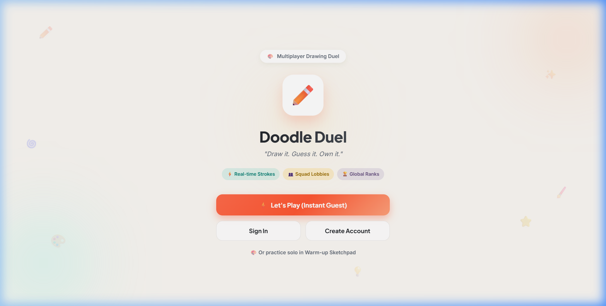
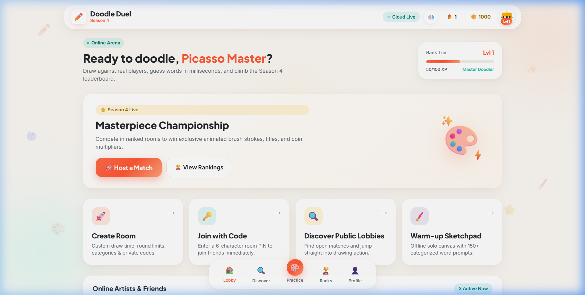
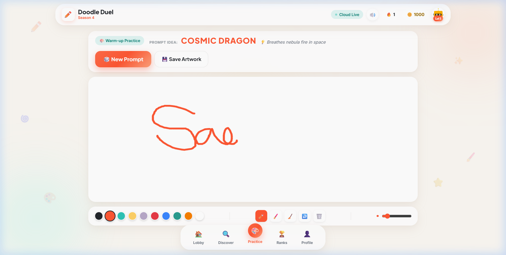

# 🎨 Doodle Duel
> **"Draw it. Guess it. Own it."**

A production-quality real-time multiplayer drawing and guessing game engineered with a **Flutter** mobile client, an **Angular 19+** modern web client, and a **Java 21 Spring Boot 3** authoritative backend, styled with a tactile **Warm Refined Glassmorphism** interface.

---

## 🌟 Highlights & Architecture

- **Visual Design System**: Faithfully reproduced from design references in `stitch_markdown_prompt_project_builder/`. Utilizes a warm root background (`#FBF8F3`), pure white canvas (`#FFFFFF`), vibrant primary coral buttons (`#FF5733`), mint accents (`#2EC4B6`), butter yellow badges (`#FFD166`), and translucent frosted glass cards.
- **Authoritative Spring Boot 3 Game Engine**: Server-authoritative state machine, turn timers, word selection, secret-word isolation, and deterministic scoring.
- **Cross-Platform Real-Time Vector Canvas**: Vector drawing event streaming with normalized coordinates $[0.0, 1.0]$ between Flutter, Angular Web, and Spring Boot, with stroke batching, undo/clear commands, and live guess feeds.
- **Offline Practice Sketchpad**: Available in both mobile and web with 150+ categorized prompts, prompt randomizer, and high-resolution export.
- **Security & Authorization**: Stateless JWT authentication with guest token generation, room isolation, and role-based drawing permissions.
- **Relational Persistence**: PostgreSQL with Flyway database migrations (`V1__init_schema.sql`) tracking users, matches, rounds, individual guesses, player placements, and career statistics.
- **Interactive OpenAPI 3 / Swagger Documentation**: Available at `http://localhost:8080/swagger-ui/index.html`.

## 📱 Mobile App (Flutter) Screenshots

| 🏠 Home Lobby | 👥 Waiting Room Lobby |
| :---: | :---: |
|  |  |

| 🎨 Main Drawing Gameplay | 💡 Real-Time Guessing Gameplay |
| :---: | :---: |
|  |  |

## 💻 Web App (Angular 19+) Screenshots

| 🌟 Web Welcome & Guest Modal | 🏠 Web Home Lobby Bento Grid | 🎨 Web Practice Sketchpad |
| :---: | :---: | :---: |
|  |  |  |

---


## 📁 Repository Structure

```
doodle-duel/
├── backend/
│   ├── src/main/java/com/doodleduel/
│   │   ├── auth/              # Guest login, user registration, JWT auth
│   │   ├── config/            # WebSecurity, WebSocket STOMP, OpenAPI configuration
│   │   ├── drawing/           # Vector stroke models, canvas state, undo/clear
│   │   ├── games/             # GameMatch, GameRound, Guess, MatchPlayerResult
│   │   │   └── engine/        # Authoritative GameEngineService, timer scheduler
│   │   ├── leaderboard/       # All-time and weekly player ranking services
│   │   ├── rooms/             # Room creation, code generation, lobby membership
│   │   ├── scoring/           # Categorized word bank, speed/drawer bonus scoring
│   │   ├── security/          # JwtTokenProvider, JwtAuthenticationFilter, ChannelInterceptor
│   │   ├── users/             # User profile, career stats, avatar management
│   │   └── websocket/         # GameEvent envelope & GameWebSocketController
│   ├── src/main/resources/
│   │   ├── application.yml    # Development configuration
│   │   └── db/migration/      # Flyway SQL schema migrations
│   ├── src/test/              # JUnit 5 & Spring Boot integration test suites
│   ├── Dockerfile             # Multi-stage production build (Eclipse Temurin Java 21)
│   └── pom.xml
├── frontend/                  # Flutter Mobile Client (iOS / Android)
│   ├── lib/
│   │   ├── app/
│   │   │   ├── router.dart    # GoRouter declarative routing with auth guards
│   │   │   └── theme/         # AppColors, AppTypography, AppTheme
│   │   ├── core/              # ApiClient (Dio), StompService, SecureStorage, GlassCard
│   │   └── features/
│   │       ├── auth/          # Welcome, Login, Register, Guest entry
│   │       ├── home/          # Home Lobby (Bento grid, stats, quick duel)
│   │       ├── rooms/         # Create room, Join with code, Discover public rooms
│   │       ├── lobby/         # Waiting lobby (player roster, host crown, ready check)
│   │       ├── gameplay/      # CustomPainter drawing canvas, guessing feed, tools
│   │       ├── results/       # RoundResultsDialog, FinalResultsScreen
│   │       ├── leaderboard/   # Ranked global standings
│   │       └── profile/       # Career statistics, settings, logout
│   ├── test/                  # Unit and widget test suite
│   └── pubspec.yaml
├── angular-frontend/          # Angular 19+ Web Client (Desktop / Mobile Browsers)
│   ├── src/
│   │   ├── app/
│   │   │   ├── core/          # Signals AuthService, StompService, SoundService, Interceptors
│   │   │   ├── features/      # Welcome, Auth, Home, Lobby, Gameplay, Sketchpad, Leaderboard
│   │   │   └── shared/        # Navbar dock, AvatarWidget, AmbientDoodle
│   │   ├── styles.css         # Warm glassmorphism design tokens & micro-animations
│   │   └── main.ts
│   └── package.json
├── stitch_markdown_prompt_project_builder/ # Design tokens, HTML layouts, and screenshots
├── docker-compose.yml         # Containerized PostgreSQL & Backend services
├── .env.example               # Environment variable templates
├── test_e2e.ps1               # Automated end-to-end integration test script
└── README.md
```

---

## 🛠️ Tech Stack

### Web Client (Angular Frontend)
- **Framework**: Angular 19+ (Standalone Components, Signals, Reactive Architecture)
- **Styling**: Vanilla CSS Warm Refined Glassmorphism (`#FBF8F3` parchment root, frosted cards)
- **Real-Time Client**: `@stomp/stompjs` & `sockjs-client` over WebSocket
- **Audio Synthesizer**: Native Web Audio API sound synthesis (zero external audio asset latency)
- **Celebrations**: `canvas-confetti`

### Mobile App (Flutter Frontend)
- **Framework**: Flutter 3.x (Dart 3 with sound null safety)
- **State Management**: `flutter_bloc` & `equatable`
- **Navigation**: `go_router`
- **Networking**: `dio` (REST) & `stomp_dart_client` (WebSockets over STOMP)
- **Canvas Rendering**: Hardware-accelerated `CustomPainter` with quadratic Bezier curve smoothing
- **Storage**: `flutter_secure_storage` for encrypted JWT storage

### Backend (Game Engine & API)
- **Language**: Java 21 LTS
- **Framework**: Spring Boot 3.3.5
- **Security**: Spring Security 6 with JJWT 0.12.6
- **Real-Time**: Spring WebSocket + In-Memory STOMP Broker
- **Data Persistence**: Spring Data JPA & PostgreSQL 16+
- **Migrations**: Flyway
- **API Documentation**: SpringDoc OpenAPI 2.6.0 (Swagger UI)

---

## 🚀 Quick Start & Local Setup

### Prerequisites
- **Java**: OpenJDK 21 LTS (`java -version`)
- **Maven**: 3.9+ (`mvn -version`)
- **Flutter**: 3.22+ (`flutter doctor`)
- **Node.js**: v18.19+ or v20+ (`node -v`)
- **Database**: PostgreSQL 16+ or Docker Desktop

---

### Option 1: Launch via Docker Compose (Recommended)

1. Clone and navigate to the project directory:
   ```bash
   cd doodle-duel
   ```
2. Start PostgreSQL and the backend container:
   ```bash
   docker-compose up -d --build
   ```
3. Verify containers are healthy:
   ```bash
   docker-compose ps
   ```
4. Access Swagger UI at `http://localhost:8080/swagger-ui/index.html`.

---

### Option 2: Native Local Launch

#### 1. Start PostgreSQL
Ensure PostgreSQL is running. For local development on port `5433`:
```bash
# Example if using PostgreSQL directly:
postgres -D "C:\Users\fahad\pgdata_doodleduel" -p 5433
```
Create database `doodleduel` with user `doodle` and password `doodlepass`.

#### 2. Start Spring Boot Backend
```bash
cd backend
mvn spring-boot:run
```
Tomcat starts on `http://localhost:8080`. Flyway automatically runs database migrations on startup.

#### 3. Run Flutter Frontend (Mobile)
```bash
cd ../frontend
flutter pub get
flutter run
```

#### 4. Run Angular Web Frontend (Browser)
```bash
cd ../angular-frontend
npm install
npm start
```
The web app opens on `http://localhost:4200/`.

---

## 📱 Mobile Networking Configuration

The mobile client is platform-aware (`frontend/lib/core/config/app_config.dart`):

| Target Environment | REST Base URL | WebSocket STOMP URL | Notes |
| :--- | :--- | :--- | :--- |
| **Android Emulator** | `http://10.0.2.2:8080/api/v1` | `ws://10.0.2.2:8080/ws` | Automatically mapped |
| **Desktop / Web / iOS Sim** | `http://localhost:8080/api/v1` | `ws://localhost:8080/ws` | Direct loopback |
| **Physical Device (LAN)** | `http://<HOST_IP>:8080/api/v1` | `ws://<HOST_IP>:8080/ws` | Set via `--dart-define=API_URL=http://<IP>:8080` |

### Connecting a Physical Device:
Ensure your computer and mobile device are on the same Wi-Fi network. Find your computer's local IP (e.g., `192.168.1.50`):
```bash
flutter run --dart-define=API_URL=http://192.168.1.50:8080/api/v1 --dart-define=WS_URL=ws://192.168.1.50:8080/ws
```

---

## 📖 REST API Contract

All endpoints reside under `/api/v1` and return a standard `ApiResponse<T>` envelope.

### Authentication (`/api/v1/auth`)
- `POST /guest`: Generate guest identity, session token, and guest display name.
- `POST /register`: Register a new persistent user with username and password.
- `POST /login`: Authenticate with credentials and receive a JWT Bearer token.

### User & Profile (`/api/v1/users`)
- `GET /me`: Fetch authenticated user profile, avatar, level, and XP.
- `PATCH /me`: Update display name, avatar URL, or bio.
- `GET /me/stats`: Fetch games played, wins, correct guesses, best score.
- `GET /me/matches`: Paginated match history for current user.

### Rooms & Lobby (`/api/v1/rooms`)
- `POST /`: Create a new public or private room.
- `POST /join`: Join an existing room via 6-character room code (e.g. `DUEL-3909`).
- `GET /{roomId}`: Retrieve room details and member roster.
- `PATCH /{roomId}/ready`: Toggle ready status for the authenticated player.
- `PATCH /{roomId}/settings`: Host-only update of difficulty, duration, and rounds.
- `POST /{roomId}/leave`: Leave the room.
- `POST /{roomId}/start`: Host-only initiation of the multiplayer match.
- `GET /public`: Paginated discover feed of public, joinable rooms.

### Match & History (`/api/v1/matches`)
- `GET /{matchId}`: Retrieve match status and metadata.
- `GET /{matchId}/results`: Retrieve final scoreboard, ranks, and XP rewards.
- `GET /my-history`: Alias for personal match history.

### Leaderboard (`/api/v1/leaderboard`)
- `GET /?period=all-time`: Global career XP rankings.
- `GET /?period=weekly`: Weekly high-score rankings.

---

## ⚡ Real-Time WebSocket Protocol (STOMP)

### Connection
- **Endpoint**: `/ws`
- **Handshake Header**: `Authorization: Bearer <JWT_TOKEN>`

### Client Subscriptions
- `/topic/rooms/{roomId}/lobby`: Roster updates, readiness toggles, player leave/join events.
- `/topic/rooms/{roomId}/drawing`: Streamed vector stroke chunks (`DRAWING_POINTS`, `DRAWING_UNDO`, `DRAWING_CLEAR`).
- `/topic/rooms/{roomId}/game`: Authoritative game state changes (`MATCH_STARTED`, `ROUND_START`, `ROUND_ENDED`, `MATCH_FINISHED`, `REACTION`).
- `/topic/rooms/{roomId}/scores`: Live guess feed and correct guess announcements (`CORRECT_GUESS`, `GUESS_FEED`).
- `/user/queue/notifications`: Private channel for the active drawer receiving `SECRET_WORD_PROMPT` and state resync payloads.

### Client Send Destinations
- `/app/rooms/{roomId}/drawing`: Drawer submits batched vector points (`DrawingStroke`).
- `/app/rooms/{roomId}/drawing/undo`: Drawer reverts their last stroke.
- `/app/rooms/{roomId}/drawing/clear`: Drawer clears canvas.
- `/app/rooms/{roomId}/guess`: Guesser submits answer string for backend evaluation.
- `/app/rooms/{roomId}/reaction`: Player broadcasts floating emoji reactions.
- `/app/rooms/{roomId}/sync`: Reconnecting client requests immediate snapshot sync.

### Secret Word Isolation Policy
1. The secret word is **never** sent over public room channels (`/topic/**`).
2. When a round begins, the backend generates masked blanks (e.g. `_ _ _ _   _ _ _ _ _`) for guessers over `/topic/rooms/{roomId}/game`.
3. The plain secret word is delivered **exclusively** to the active drawer's private queue (`/user/queue/notifications`).
4. Guess comparison occurs strictly server-side using case-insensitive normalization.

---

## 🧪 Testing & Verification

### Run Backend Tests (JUnit 5 + Spring Boot Test)
```bash
cd backend
mvn test
```
*Result: **18 tests passing**, covering authentication, drawing state buffer, score calculations, word banks, token validation, and the full end-to-end `GameEngineIntegrationTest`.*

### Run Flutter Static Analysis & Tests
```bash
cd frontend
flutter analyze
flutter test
```
*Result: **0 issues found** on static analysis. **7/7 unit and widget tests passing**.*

### Run Angular Build & Verification
```bash
cd angular-frontend
npm run build
```
*Result: **0 errors, 0 warnings**. Production AOT bundle generated in `dist/angular-frontend/browser`.*

### Run Live End-to-End Game Script
With Spring Boot running, execute the automated multi-player script:
```powershell
powershell -ExecutionPolicy Bypass -File test_e2e.ps1
```
*Verifies 2 independent player guest logins, room creation, code joining, readiness check, match initiation, room state transitions, and leaderboard persistence.*

---

## 🌐 Angular Web Application Architecture

The web client (`angular-frontend/`) is engineered with **Angular 19+** standalone components, Angular Signals, and modern TypeScript:

- **Warm Refined Glassmorphism UI**: Faithfully replicates the Flutter mobile experience using standard CSS custom properties matching `AppColors` (`#FBF8F3` parchment background, `#FF5733` primary coral, `#2EC4B6` mint, `#FFD166` yellow, and frosted glass cards).
- **Cross-Platform HTML5 Vector Canvas**: Hardware-accelerated canvas utilizing normalized $[0.0, 1.0]$ coordinates for 100% interoperability with Flutter and Spring Boot. Features a 10-color tactile palette, brush slider, undo/clear, and real-time STOMP vector streaming.
- **Offline Practice Sketchpad**: Full drawing suite with **150+ categorized prompts** (Easy, Medium, Hard, Pop Culture), prompt randomizer, and high-resolution PNG export (`doodle-duel-practice.png`).
- **Web Audio API Sound Engine**: Synthesizes tactile pops, correct guess chimes, tick-tock countdowns, and victory fanfares without external audio asset downloads.
- **Dynamic Cloud / Localhost Switcher**: Header controls allowing seamless switching between the Render cloud API (`https://doodle-duel-9wbf.onrender.com`) and local development server (`http://localhost:8080`).

---

## ☁️ Deployment & Cloud Hosting (Render)

This repository includes a turnkey [`render.yaml`](render.yaml) blueprint for 1-click deployment on [Render](https://render.com).

### 1. Deploy Angular Web Frontend (Static Site - Free, Global CDN)
- **Root Directory**: `angular-frontend`
- **Build Command**: `npm install && npm run build`
- **Publish Directory**: `dist/angular-frontend/browser`
- **SPA Routing Rewrite Rule**: In Render dashboard under **Redirects/Rewrites**, add `/*` $\rightarrow$ `/index.html` (Rewrite).

### 2. Deploy Spring Boot Backend (Docker Web Service)
- **Root Directory**: `backend`
- **Runtime**: `Docker` (Automatically detects and builds `backend/Dockerfile` with Java 21)
- **Port**: Render automatically provisions and maps the dynamic `$PORT` environment variable.

---

## 🎨 Visual Design Tokens Reference

| Token Name | Hex Code | Purpose |
| :--- | :--- | :--- |
| `backgroundRoot` | `#FBF8F3` | Warm parchment main screen background |
| `surfaceSolid` | `#FFFFFF` | Solid opaque drawing canvas |
| `primaryCoral` | `#FF5733` | Primary action CTAs and active indicators |
| `accentMint` | `#2EC4B6` | Correct guess celebrations & readiness badges |
| `accentYellow` | `#FFD166` | Host crown, streaks, and coin counters |
| `accentLavender` | `#B8A9C9` | Secondary category chips and decorative squiggles |
| `textPrimary` | `#22252A` | High-contrast typography headings |
| `textSecondary` | `#636B78` | Subheadings and meta labels |
| `textMuted` | `#9AA0A6` | Placeholders and inactive indicators |
| `glassBackground` | `rgba(255, 255, 255, 0.82)` | Frosted glass card fill |
| `glassBorder` | `rgba(255, 255, 255, 0.60)` | Subtle warm glass border |

---

## 📄 License
This project is open-source and available under the Apache 2.0 License.
